## HASIL PRAKTIKUM 
Hasil Praktikum Pertemuan 2

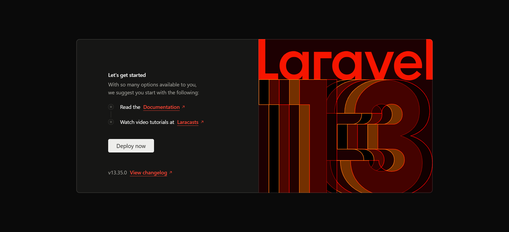

Hasil Praktikum Pertemuan 3

1. 
2. 
3. 

Hasil Latihan Mandiri & Tugas - Pertemuan 3

1.   
3. 
4. 
5. 
6. 

Hasil Praktikum Pertemuan 4

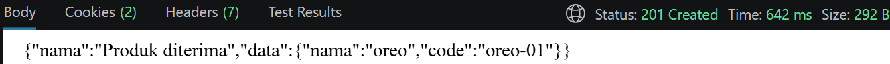

Hasil Latihan Mandiri & Tugas Pertemuan 4

1. 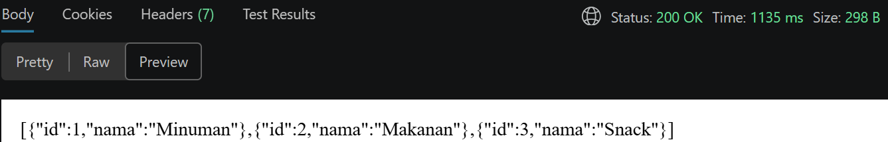
2. 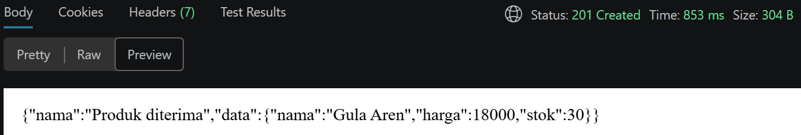
3. 
4. 

Hasil Praktikum Pertemuan 5

1. 
2. 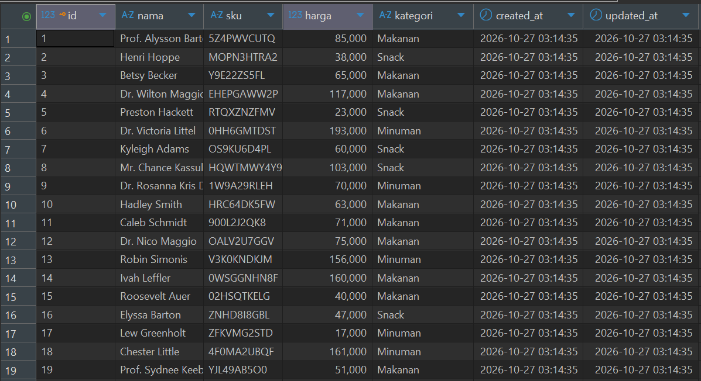

Hasil Praktikum Pertemuan 6

1. POST -> 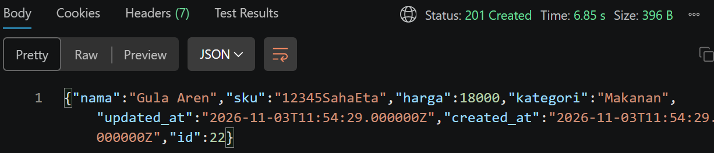
2. GET -> 

Tugas Praktikum Pertemuan 6 (Update dan Delete)
1. "Add" untuk pengujian
   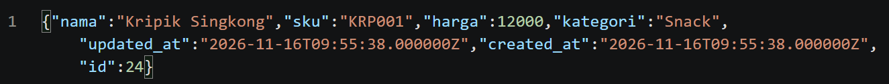
3. Update
   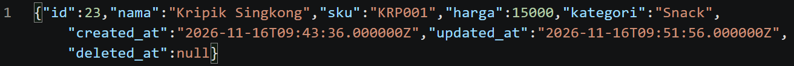
5. Delete
   
   --> Softdelete
   
   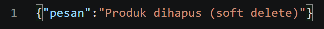
   
   --> Harddelete
   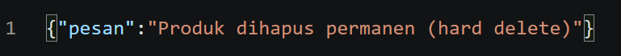
   
Hasil Praktikum Pertemuan 7 (Validasi Error)
1. Validasi Error
   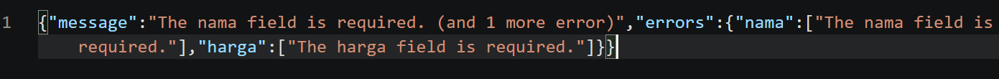
   ---> Validasi Input
   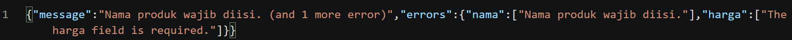
   ---> Validasi Update
   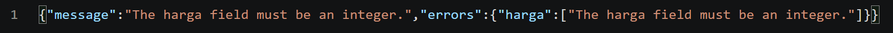
   
Hasil Praktikum Pertemuan 8 (Relasi dan Autentika API)
1. Relasi
   
   --> Relasi GET
   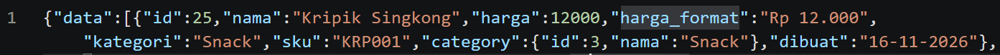
   --> Relasi POST
   
      ---> POST 1
   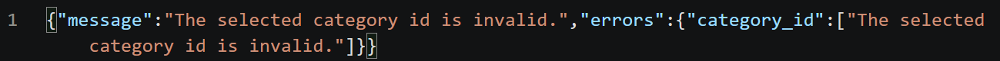
   
      ---> POST 2
   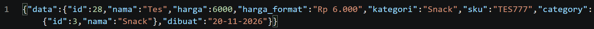
3. Autentika API
   
   --> Register
   
   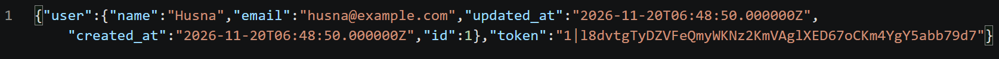
   --> Login
   
   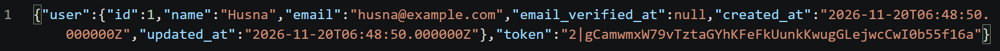

=============================================================================
## Ujian Tengah Semester 5
Hasil Tampilan Program UTS
1. Daftar Produk ---> dapat Menampilkan, Menambah, Mengubah, Menghapus dan Mencari (tambahan).
   
   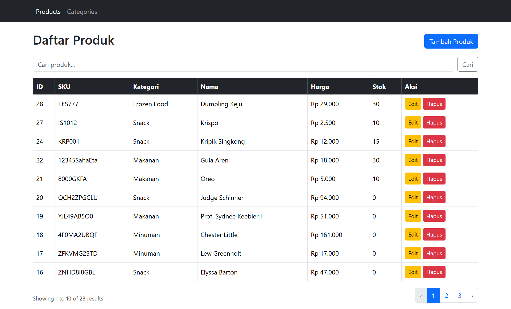
   
3. Daftar Kategori ---> Memverifikasi bahwa relasi berhasil ---> berisi kolom pencarian (tambahan)
   
   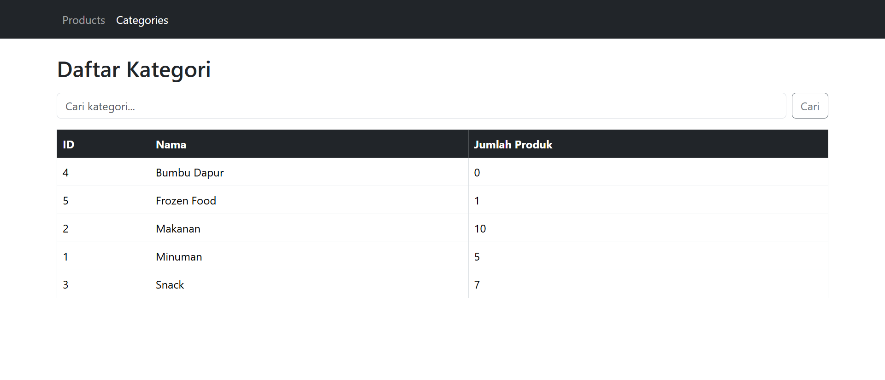
   
=============================================================================
   
