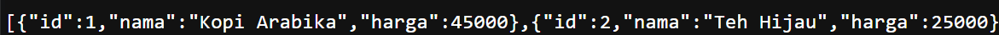
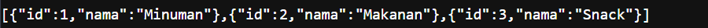
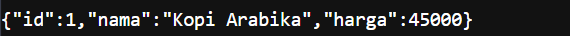
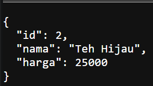
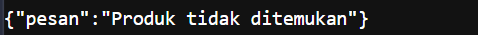
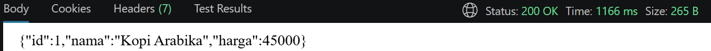
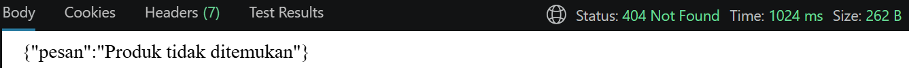
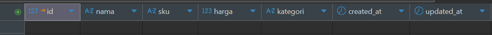
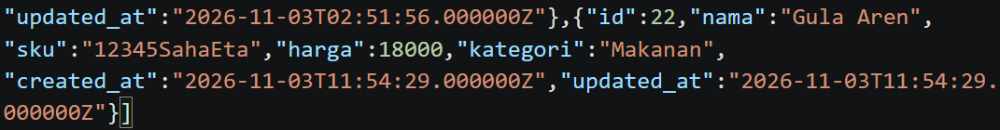

Hasil Praktikum Pertemuan 2

Hasil Praktikum Pertemuan 3

1. 
2. 
3. 

Hasil Latihan Mandiri & Tugas - Pertemuan 3

1.   
3. 
4. 
5. 
6. 

Hasil Praktikum Pertemuan 4

Hasil Latihan Mandiri & Tugas Pertemuan 4

1. 
2. 
3. 
4. 

Hasil Praktikum Pertemuan 5

1. 
2. 

Hasil Praktikum Pertemuan 6

1. POST -> 
2. GET -> 

Tugas Praktikum Pertemuan 6 (Update dan Delete)
1. "Add" untuk pengujian
2. Update
3. Delete
   -> Softdelete
   -> Harddelete
Hasil Praktikum Pertemuan 7 (Validasi Error)
1. Validasi Error
   -> Validasi Input
   -> Validasi Update
Hasil Praktikum Pertemuan 8 (Relasi dan Autentika API)
1. Relasi
   -> Relasi GET
   -> Relasi POST
   a. POST 1
   b. POST 2
3. Autentika API
   -> Register
   -> Login

