Hasil Praktikum Pertemuan 2

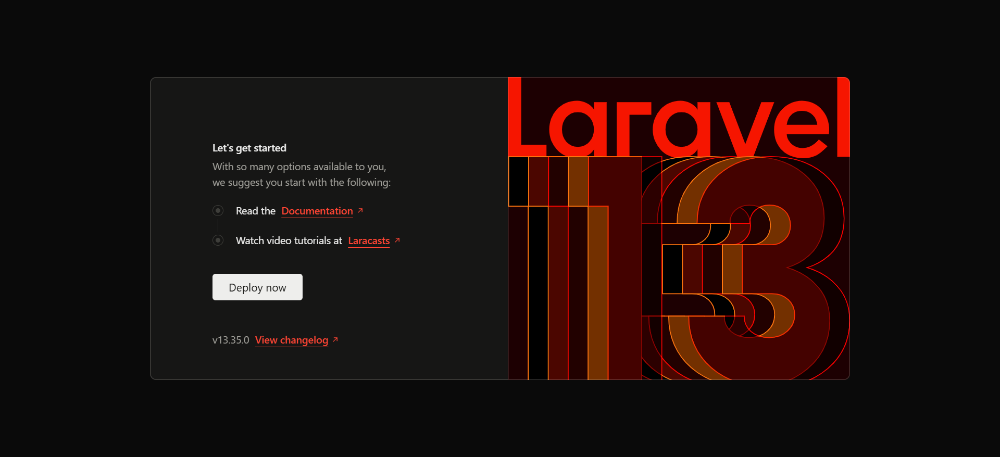

Hasil Praktikum Pertemuan 3

1. 
2. 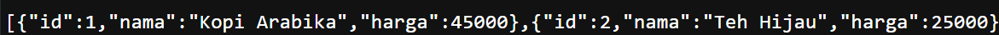
3. 

Hasil Latihan Mandiri & Tugas - Pertemuan 3

1.   
3. 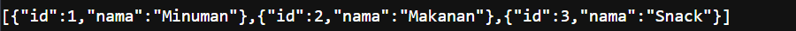
4. 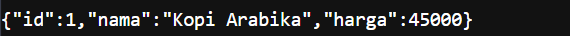
5. 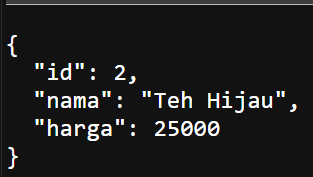
6. 

Hasil Praktikum Pertemuan 4

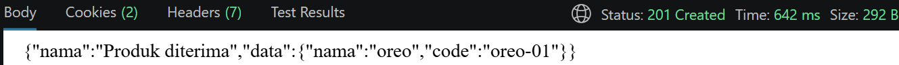

Hasil Latihan Mandiri & Tugas Pertemuan 4

1. 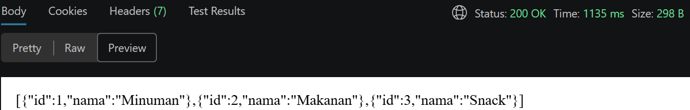
2. 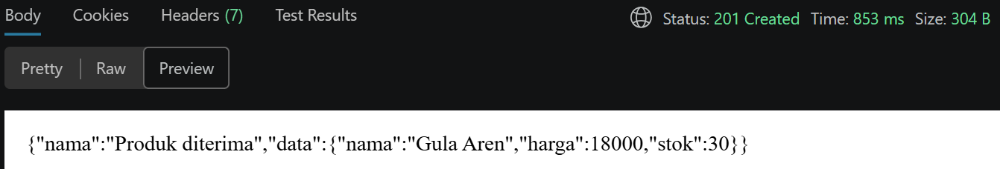
3. 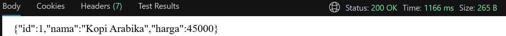
4. 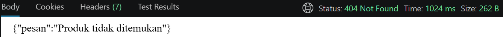

Hasil Praktikum Pertemuan 5

1. 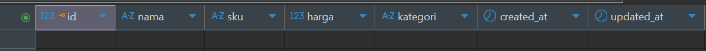
2. 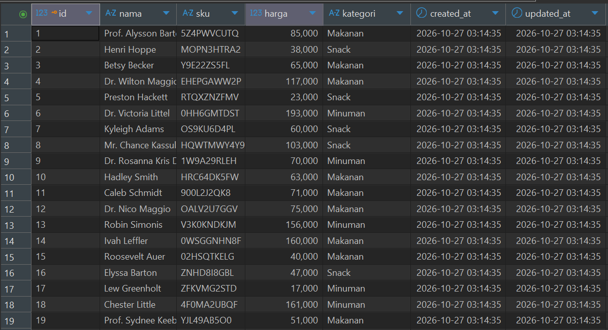

Hasil Praktikum Pertemuan 6

1. POST -> 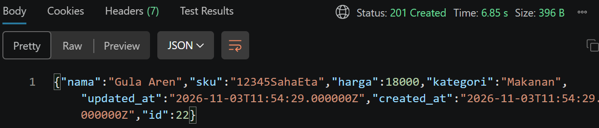
2. GET -> 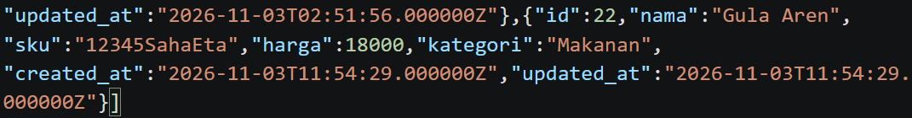

Tugas Praktikum Pertemuan 6 (Update dan Delete)
1. Update
   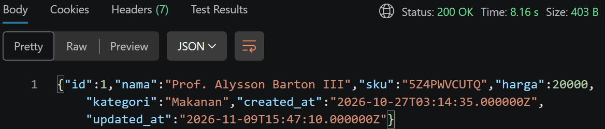
3. Delete ->
   
   Before Delete :
   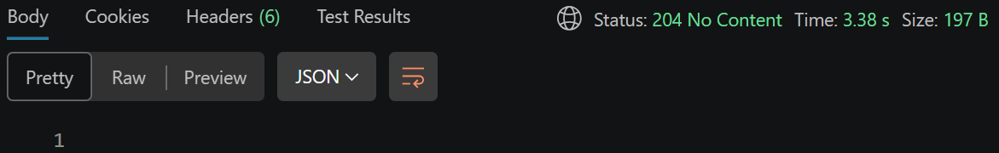
   After Delete :
   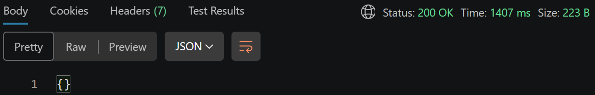 -> karena products id 1 telah dihapus maka saat dipanggil data akan kosong.

